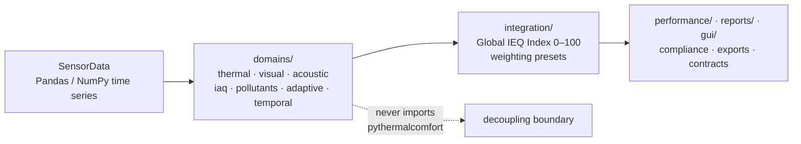

<!-- markdownlint-disable MD033 MD041 -->
<p align="center">
  
</p>

<h1 align="center">comfio</h1>

<p align="center">
  <b>Multi-domain Indoor Environmental Quality (IEQ) analysis for smart buildings —<br/>
  thermal, visual, acoustic, and air quality unified into one index.</b>
</p>

<p align="center">
  <a href="https://pypi.org/project/comfio/"></a>
  <a href="https://pypi.org/project/comfio/"></a>
  <a href="https://github.com/NibrasAz7/comfio/actions/workflows/test.yml"></a><br/>
  <a href="https://comfio.readthedocs.io/"></a>
  <a href="https://github.com/NibrasAz7/comfio/blob/main/LICENSE"></a>
  <a href="https://pepy.tech/project/comfio"></a>
  
  <!-- [TODO: Zenodo DOI badge] -->
</p>

Building IEQ data lives in silos — PMV spreadsheets here, CO₂ logs there,
lux-meter readings somewhere else — and nobody can answer "is this space
actually comfortable *and* compliant?" comfio pulls those streams into one
NumPy-native pipeline and returns a weighted **Global IEQ Index (0–100)**
with EN 16798-1 time-in-category compliance over your whole dataset.

> **Status:** v0.x beta. Core domains (thermal, visual, acoustic, IAQ,
> temporal) are stable and tested; physics extras (daylighting,
> psychrometrics) are functional but less battle-tested.

## Contents

- [Why comfio](#why-comfio) · [Install](#installation) ·
  [Quick start](#quick-start) · [Long-term IEQ](#long-term-ieq--time-in-categories-en-16798-1) ·
  [GUI](#gui--analyst-workbench) · [Domains](#domain-modules) ·
  [Colab](#try-it-in-colab) · [Architecture](#architecture) ·
  [Citation](#citation) · [Development](#development)

## Why comfio

- **One API for four domains** — PMV/PPD, sPMV, adaptive comfort, TSV votes,
  CO₂ + PM2.5/PM10/TVOC/HCHO/CO, illuminance, LAeq → single index
- **Long-term compliance, not just snapshots** — % of occupied time per
  EN 16798-1 category I–IV, per domain, whole-series or per-day
- **Built for time series** — Pandas/NumPy arrays, occupancy masks,
  irregular sampling handled by time-weighting
- **Decoupled by design** — `integration/` never touches `pythermalcomfort`
  directly; upstream breakage stays contained
- **Contract-ready** — compliance rates and JSON/ABI outputs for
  performance-contract and oracle workflows
- **Honest scope** — every result carries its standard (ISO 7730, ASHRAE
  55/62.1, EN 12464-1, EN 16798-1, WHO/EPA/WELL) in the docstring

## Installation

```bash
pip install comfio          # core: numpy, pandas, pythermalcomfort
```

Optional extras (install only what you need):

| Extra | Adds |
| --- | --- |
| `comfio[ml]` / `[torch]` / `[keras]` | sklearn / PyTorch / TF adapters |
| `comfio[gui]` | Streamlit workbench + notebook widget |
| `comfio[gui-reports]` | + PDF/DOCX exports |
| `comfio[daylighting]` | pyradiance ray-tracing |
| `comfio[color]` | CRI/CCT colour science |
| `comfio[acoustics]` | RT60, STI |
| `comfio[psychrometrics]` | PsychroLib, CO₂-decay ACH |
| `comfio[all]` | everything |

Requires Python ≥ 3.11.

## Quick start

```python
import numpy as np
from comfio import (
    evaluate_thermal, evaluate_visual, evaluate_acoustic, evaluate_iaq,
    calculate_global_ieq, default_weights, calculate_compliance,
)

thermal = evaluate_thermal(
    tdb=[24.0, 25.0, 26.0], tr=[24.0, 25.0, 26.0],
    vr=[0.1, 0.1, 0.1], rh=[50.0, 50.0, 50.0],
    met=1.2, clo=0.5, category="B",
)
visual  = evaluate_visual(illuminance=[450.0, 500.0, 600.0],
                          task_type="office_writing")
acoustic = evaluate_acoustic(laeq=[35.0, 40.0, 45.0], nc_level="NC-35")
iaq     = evaluate_iaq(co2=[700.0, 900.0, 1100.0],
                       threshold_level="good")

ieq = calculate_global_ieq(
    thermal=thermal, visual=visual, acoustic=acoustic, iaq=iaq,
    weights=default_weights(),     # thermal 40 · iaq 25 · visual 20 · acoustic 15
)
# → ieq.index ≈ 78.2   (0–100)

report = calculate_compliance(ieq, threshold=80.0)
# → report.compliance_rate_pct, report.to_contract_json()
```

Time-series data? `SensorData(df)` auto-detects columns, validates
bounds, and `run_pipeline(sensor)` evaluates **all** domains plus
temporal summaries in one call.

**Zero-install option:** every tutorial runs in Colab —
[`examples/simple_tutorial.ipynb`](examples/simple_tutorial.ipynb):

[](https://colab.research.google.com/github/NibrasAz7/comfio/blob/main/examples/simple_tutorial.ipynb)

## Long-term IEQ — time in categories (EN 16798-1)

```python
from comfio import evaluate_temporal_thermal

s = evaluate_temporal_thermal(result, timestamps=df["timestamp"])
s.percentages   # {'I': 20.0, 'II': 68.0, 'III': 7.0, 'IV': 5.0}
s.cumulative    # {'I': 20.0, 'I+II': 88.0, 'I+II+III': 95.0, ...}
s.hours         # occupied hours per category (time-weighted)
daily = evaluate_temporal_thermal(result, timestamps=df["timestamp"], by="D")
```

One wrapper per domain, all returning `TimeInCategoryResult`:
`evaluate_temporal_{thermal, tsv, adaptive, iaq, pollutant, visual, acoustic}`.
`run_pipeline()` fills `result.temporal_results` automatically.

> Full worked example (synthetic year, all 10 evaluations, run in CI):
> [`examples/temporal_ieq_example.py`](examples/temporal_ieq_example.py)

## GUI — analyst workbench

```python
import comfio
comfio.gui()              # browser app on localhost:8501
comfio.gui(df)            # preloaded DataFrame
comfio.gui(desktop=True)  # native pywebview window
comfio.gui(tools=["workbench", "calculator"])  # subset of tools
```

Multipage Streamlit tools: **workbench** (upload → map → verdict →
evidence/exports), **survey**, **calculator** (PMV/SET/adaptive +
psychrometric chart), **mrt** room designer, **setpoint** explorer,
**benchmark** (ASHRAE DB II), **learn**, **about**. Requires
`comfio[gui]`; deployable to Streamlit Community Cloud via the shipped
`streamlit_app.py`.

## Domain modules

| Module | Functions | Standard |
| --- | --- | --- |
| Thermal | `evaluate_thermal`, `evaluate_spmv`, `evaluate_adaptive_{ashrae,en}`, `evaluate_{ankle_draft,vertical_gradient}`, `train_personalisation` | ISO 7730, ASHRAE 55, EN 16798-1, Buratti 2009 |
| IAQ | `evaluate_iaq`, `evaluate_iaq_pollutants` | ASHRAE 62.1, WHO 2021, EPA NAAQS, WELL v2 |
| Occupant | `evaluate_tsv`, `augment_tsv_cdf` | ASHRAE 55-2023 App. L |
| Visual | `evaluate_visual`, `evaluate_color_quality`, `evaluate_daylighting` | EN 12464-1, CIE 13.3/015 |
| Acoustic | `evaluate_acoustic`, `evaluate_reverberation`, `evaluate_speech_intelligibility` | NC curves, ISO 3382-2, IEC 60268-16 |
| Temporal | `evaluate_temporal_*`, `summarize_time_in_categories` | EN 16798-1 Annex B |
| Integration | `calculate_global_ieq`, `calculate_compliance`, `run_pipeline` | Pierson et al. 2019 |

Extras shown above cover daylighting (pyradiance), colour (CRI/CCT),
reverberation/STI, psychrometrics + CO₂-decay ventilation (psychrolib),
and meteostat weather fetch for adaptive models.

## Try it in Colab

| Notebook | Description | Open in Colab |
| --- | --- | --- |
| `walkthrough_executed.ipynb` | End-to-end: all domains → Global IEQ → compliance → ML → contracts → reports | [](https://colab.research.google.com/github/NibrasAz7/comfio/blob/main/examples/walkthrough_executed.ipynb) |
| `simple_tutorial.ipynb` | Quick start: core domains + Global IEQ + compliance | [](https://colab.research.google.com/github/NibrasAz7/comfio/blob/main/examples/simple_tutorial.ipynb) |
| `advanced_domains_tutorial.ipynb` | Daylighting, CRI/CCT, RT60, STI, ventilation, psychrometrics | [](https://colab.research.google.com/github/NibrasAz7/comfio/blob/main/examples/advanced_domains_tutorial.ipynb) |
| `llm_tutorial.ipynb` | LLM interpreters, prompts, OpenAI/LangChain tool schemas | [](https://colab.research.google.com/github/NibrasAz7/comfio/blob/main/examples/llm_tutorial.ipynb) |
| `contracts_ml_tutorial.ipynb` | Compliance ABI, web3.py, sklearn/PyTorch/Keras forecasting | [](https://colab.research.google.com/github/NibrasAz7/comfio/blob/main/examples/contracts_ml_tutorial.ipynb) |

Executed variants sit next to each notebook in
[`examples/`](https://github.com/NibrasAz7/comfio/tree/main/examples);
five more docs tutorials live in
[`docs/tutorials/`](https://github.com/NibrasAz7/comfio/tree/main/docs/tutorials).
In Colab: `!pip install comfio[all]` in the first cell.

## Architecture



`integration/` only talks to `domains/` — if `pythermalcomfort` breaks
upstream, only `domains/thermal.py` changes.

### Weighting presets

| Preset | Thermal | IAQ | Visual | Acoustic | Use case |
| --- | --- | --- | --- | --- | --- |
| `default` | 40% | 25% | 20% | 15% | General (Pierson 2019) |
| `equal` | 25% | 25% | 25% | 25% | Equal weighting |
| `school` | 27% | 26% | 24% | 23% | School children |
| `office` | 45% | 30% | 15% | 10% | Office workers |
| `healthcare` | 25% | 40% | 15% | 20% | Healthcare |

```python
from comfio.integration.weights import preset_weights, custom_weights
w = preset_weights("office")            # or custom_weights(...)
```

## Citation

<details>
<summary><b>Cite comfio</b> — BibTeX + per-function references</summary>

```bibtex
@software{comfio,
  author  = {ABO ALZAHAB, Nibras},
  title   = {comfio: A Multi-Domain IEQ \& Performance Contract
             Framework for Smart Buildings},
  year    = {2026},
  url     = {https://github.com/NibrasAz7/comfio},
  version = {0.1.9.3},
}
```

comfio wraps peer-reviewed methods — cite the underlying work too:
pythermalcomfort (Tartarini & Schiavon 2020), Fanger (1970),
Buratti et al. (2009), de Dear & Brager (1998), Pierson et al. (2019),
WHO (2021). The full per-function citation table is in the
[docs](https://comfio.readthedocs.io/en/stable/). Machine-readable
metadata: [`CITATION.cff`](CITATION.cff).
</details>

## Development

```bash
pip install -e ".[dev]"
pytest            # 3.11–3.13 in CI
ruff check src/ tests/
mypy src/comfio/
```

## License

MIT — see [LICENSE](LICENSE).
